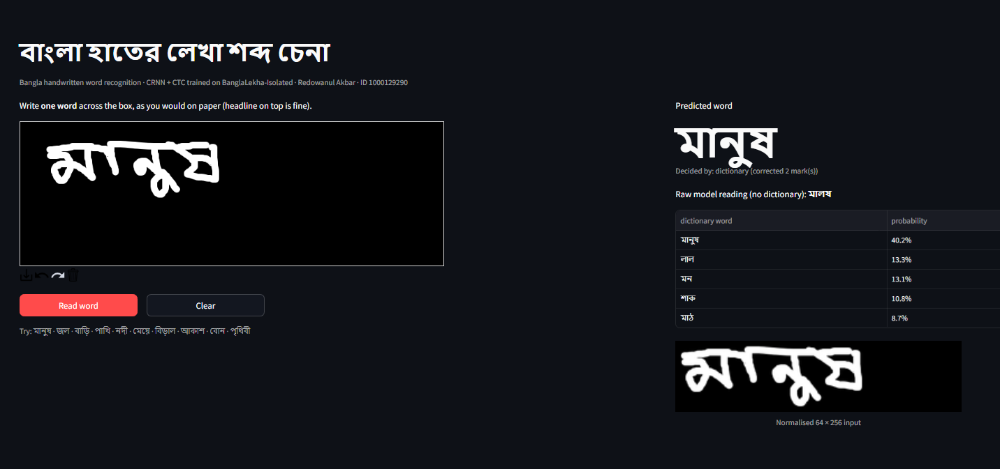
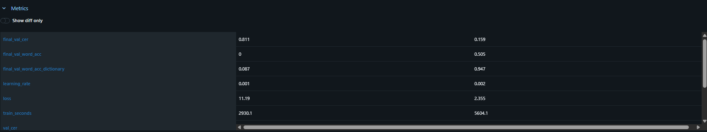

# Bangla Handwritten Word Recognition (Assignment 04)

**Name:** Redowanul Akbar
**Student ID:** 1000129290
**Course:** Skills for Industry Competitiveness and Innovation Program (SICIP), BRAC University

You write one Bangla word on a canvas, for example মানুষ or জল, and the app returns the whole word as Unicode text. The model is trained on letters from the BanglaLekha-Isolated dataset, every training run is recorded in MLflow, and the app runs in Docker.



## Approach

### The problem with the dataset

BanglaLekha-Isolated contains single handwritten characters (vowels, consonants, numerals and some conjuncts), one per image. It has no words and no vowel signs (kar). A word like মানুষ needs the signs া and ু, which never appear in the dataset on their own.

### Building words from letters

`train.py` creates its own word images while it trains:

1. It loads real handwritten letters from BanglaLekha folders 1–49 (11 vowels and 38 consonants and signs; chandrabindu is left out because it sits on top of another letter).
2. For each training example it picks a word, either from `lexicon.txt` (450 everyday words) or a random string of letters, so the model can't just memorise the dictionary.
3. Each letter of the word is replaced by a random handwritten sample of that letter, scaled and placed side by side.
4. The vowel signs are drawn as pen strokes with small random wobble: া and ী in their own column, ি, ে and ৈ before the letter, ু, ূ and ৃ underneath it. ো is written as ে + letter + া, the way people write it.
5. Most words also get a headline (matra) joining the letters, then random shear, rotation, stroke thickness, blur and noise.

Because every batch is drawn fresh, the model never sees the same image twice.

### Model: CRNN with CTC loss

The network reads the 64 × 256 word strip from left to right instead of cutting it into characters:

| Part                                    | What it does                                                                 |
| --------------------------------------- | ---------------------------------------------------------------------------- |
| 6 convolution blocks (32 → 128 filters) | Find stroke patterns. Pooling shrinks height to 4 but keeps 64 columns.      |
| Dense + 2 bidirectional LSTMs           | Read the 64 columns as a sequence, using context from both sides.            |
| Dense output (58 classes)               | For every column: one of 57 marks or a blank.                                |
| CTC loss                                | Trains the sequence output without needing to know where each letter starts. |

The model outputs marks in the order they are written (ে before ম in মে), and `ocr_core.visual_to_word()` moves them back into Unicode order, so the app prints proper text such as মেয়ে and বোন.

### Decoding the whole word

`app.py` gets two answers from the model output:

- **Raw reading:** the most likely mark per column, repeats merged, blanks removed.
- **Dictionary-guided:** the CTC probability of every word in `lexicon.txt` (plus any words typed into the sidebar) is computed exactly with the CTC forward algorithm. If the raw reading is close to the best word (at most half its marks differ), the dictionary word is shown. Otherwise the raw reading is shown, so words outside the dictionary still come through.

The page shows the final word in large text, the raw reading, the top five dictionary candidates with probabilities, and the normalised image the model received.

### What MLflow records

Each `python train.py` call is one run in the experiment `bangla-word-ocr`:

- **Parameters:** epochs, learning rate, batch size, LSTM size, dictionary share, letters per class, model size
- **Metrics per epoch:** train and validation CTC loss, character error rate (CER), word accuracy with and without the dictionary, learning rate
- **Artifacts:** training curves, sample validation words, one sample from every BanglaLekha folder (to check the folder-to-letter mapping), a TSV of every validation prediction, `labels.json` and the trained `model.keras`

The validation set is built from letter images held out from training (12% per class), so it measures how well the model reads handwriting it hasn't seen.

After each run, `train.py` copies the model to `models/model.keras` only if its validation CER beats the current one (recorded in `models/model_card.json`). The app therefore always serves the best run.

## Project structure

```
bangla-ocr-assignment/
|-- train.py              # synthetic words + CRNN training + MLflow logging
|-- app.py                # Streamlit page: draw a word, get the word
|-- ocr_core.py           # shared: paths, Bangla tokens, image normalisation, CTC decoding
|-- lexicon.txt           # dictionary for training words and guided decoding
|-- labels.json           # model classes and the BanglaLekha folder → letter map
|-- requirements.txt
|-- Dockerfile
|-- models/
|   |-- model.keras       # created by train.py
|   `-- model_card.json   # which run the app is using
|-- artifacts/
|   `-- mlflow/           # mlflow.db + run artifacts, created by train.py
`-- screenshots/
    |-- streamlit_app.png
    `-- mlflow_experiment.png
```

## How to run

Tested with Python 3.11 on Linux. Python 3.10 also works.

### 1. Set up the environment

```bash
git clone https://github.com/rednation446/bangla-ocr-assignment.git
cd bangla-ocr-assignment
python3.11 -m venv .venv
source .venv/bin/activate          # Windows: .venv\Scripts\activate
pip install --upgrade pip
pip install -r requirements.txt
```

### 2. Get the dataset

Download BanglaLekha-Isolated from Mendeley Data: <https://data.mendeley.com/datasets/hf6sf8zrkc/2> ("Download All"), then unzip it inside `data/`:

```bash
mkdir -p data
unzip ~/Downloads/BanglaLekha-Isolated*.zip -d data/
```

`train.py` searches `data/` for the numbered class folders (`1`, `2`, … `84`), so the exact folder nesting doesn't matter. If the download is a zip inside a zip, unzip the inner one too.

### 3. Train (two runs)

```bash
python train.py                                                  # run 1: defaults, 15 epochs, lr 1e-3
python train.py --epochs 25 --learning-rate 5e-4 --run-name crnn-e25-lr5e-4   # run 2
```

On a 4-core laptop CPU one epoch takes roughly one to two minutes. Useful options: `--per-class` (letters loaded per class, default 800), `--steps-per-epoch`, `--batch-size`, `--lstm-units`, `--lexicon-ratio`, `--always-save`.

### 4. Look at the runs in MLflow

```bash
mlflow ui --backend-store-uri sqlite:///artifacts/mlflow/mlflow.db --host 0.0.0.0 --port 5000
```

Open <http://localhost:5000>, select the experiment `bangla-word-ocr` and tick both runs to compare them.

### 5. Run the app

```bash
streamlit run app.py
```

Open <http://localhost:8501>, write a word across the black box, and press **Read word**.

### 6. Run with Docker

The image copies `models/model.keras`, so train first.

```bash
docker build -t bangla-ocr-app:0.1 .
docker run -p 8501:8501 bangla-ocr-app:0.1
```

Then open <http://localhost:8501>. The image uses `tensorflow-cpu` and leaves out MLflow and matplotlib, which only training needs.

## Results

The MLflow page with both runs is in `screenshots/mlflow_experiment.png`. The run the app uses, with its validation CER and word accuracy, is listed in `models/model_card.json` and in the app's sidebar.



## Limitations

- **Vowel signs are drawn by code, not by people.** The dataset has no kar samples, so their shapes come from a stroke generator. Signs written in an unusual style are the most common source of errors.
- **No conjuncts.** Words with যুক্তবর্ণ (for example বন্ধু, স্কুল) cannot be read. BanglaLekha's 24 compound classes were not used, and ঁ, ৌ, ্য and ্র are not modelled.
- **Synthetic validation.** Validation words are built the same way as training words, from unseen letter images. Accuracy on real handwritten words, especially words drawn with a mouse, will be lower than the MLflow numbers.
- **Dictionary bias.** Guided decoding can pull an unusual word towards a similar dictionary word. Turn the toggle off in the sidebar to see the raw reading, or add the word in the sidebar.
- **Scanned letters vs. canvas strokes.** BanglaLekha letters were written with pens on paper and scanned. Thick, evenly sized writing on the canvas works best.
- **Fixed input size.** Every word is scaled into 64 × 256 pixels, so long words get small, and very long words are harder to read.
- **Folder order.** `labels.json` assumes BanglaLekha folders 1–50 follow the alphabet order of the collection form. The artifact `banglalekha_folders.png` in each MLflow run shows one sample per folder so this can be checked.
